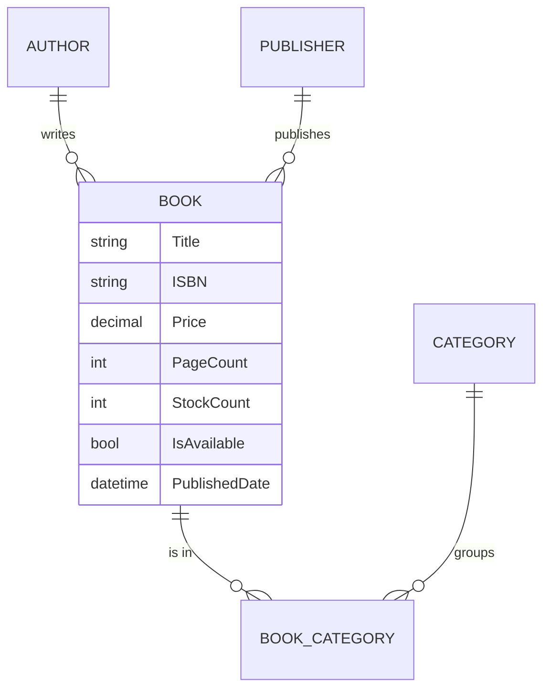

# Bookstore Management (.NET)

Early-stage .NET 8 project for a bookstore back office, set up with **clean architecture**.
The domain model is in place; persistence and API endpoints were not built before the project was archived.

## Domain model

- Many-to-many between books and categories through a `BookCategory` join entity.
- Shared `BaseEntity` with id, created / updated timestamps and a soft-delete flag.
- `BookDetailsDto` in the application layer for read models.

## Projects

| Project | Status |
|---|---|
| `Domain` | Entities: `Book`, `Author`, `Publisher`, `Category`, `BookCategory`, `BaseEntity` |
| `Application` | `BookDetailsDto` |
| `Infrastructure` | Empty project, reserved for EF Core |
| `Presentation` | ASP.NET Core Web API host with Swagger |

*Archived. See [ecommerce-microservices](https://github.com/Dogukanyllmaz/ecommerce-microservices) for a complete clean-architecture implementation.*
